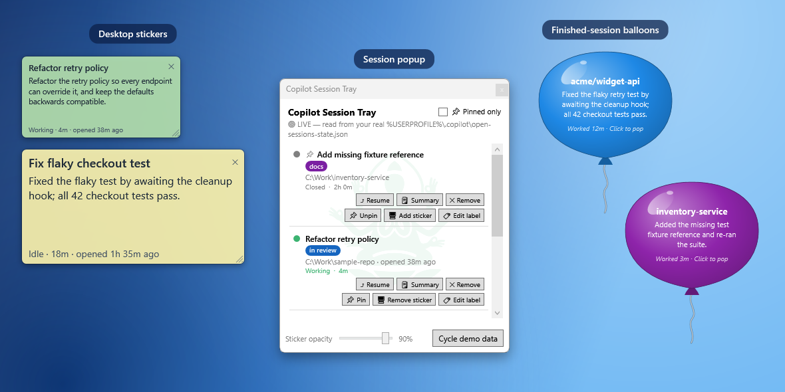
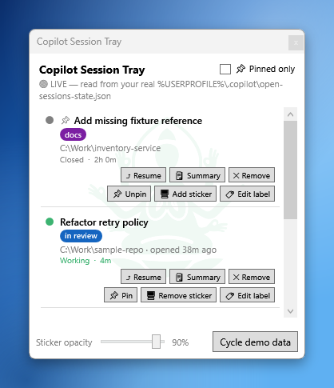
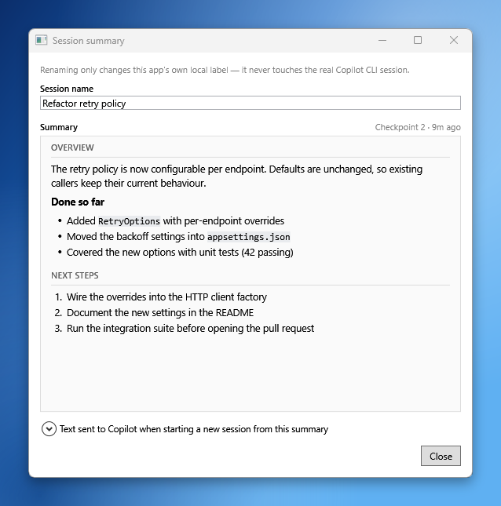
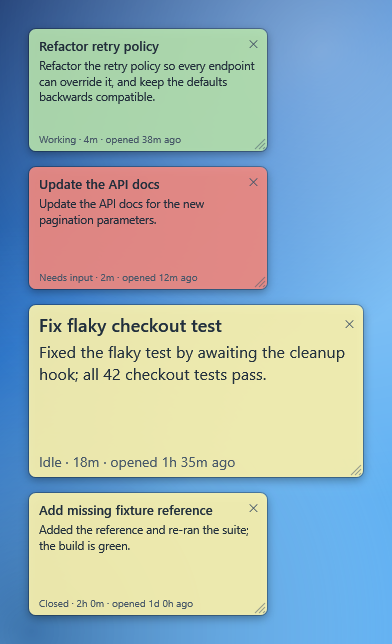
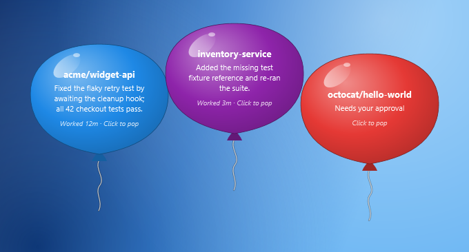
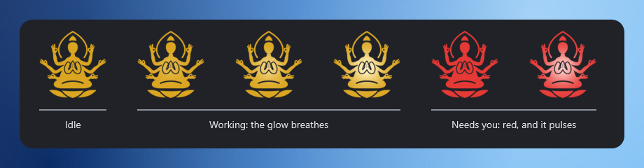
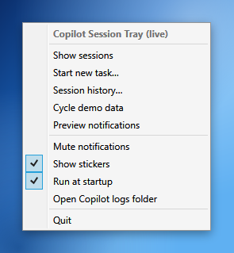
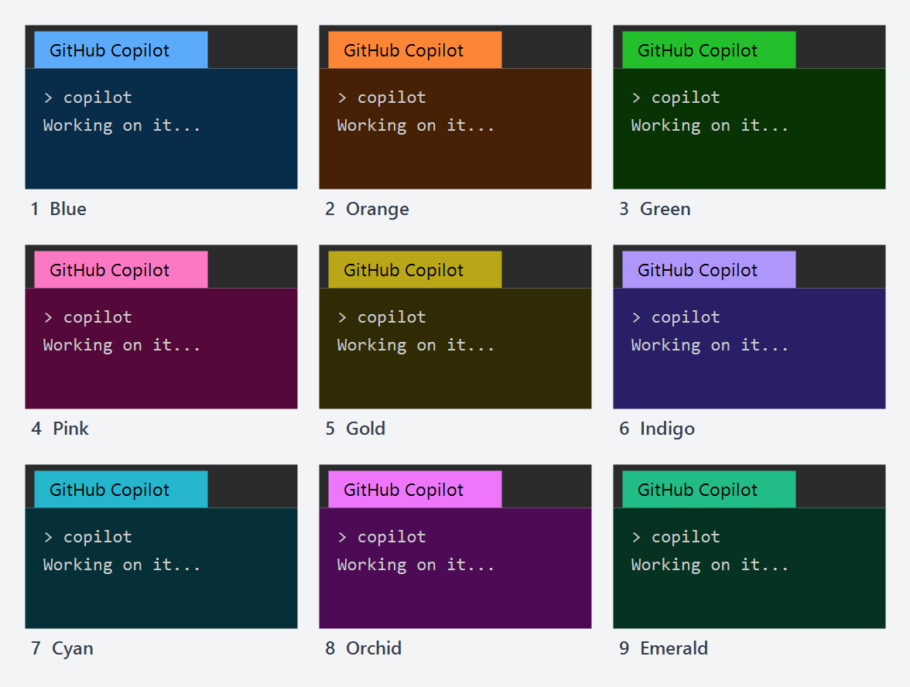

# Copilot Session Tray

Personal Windows tray utility to monitor GitHub Copilot CLI sessions: see at
a glance whether Copilot is running, whether any session is actively
working, and get notified when a session finishes unattended.

See [`IMPLEMENTATION_PLAN.md`](./IMPLEMENTATION_PLAN.md) for the full design,
research findings, architecture, and phased plan. See
[`ROADMAP.md`](./ROADMAP.md) for future ideas (desktop pet mode, a macOS
port) that aren't scheduled yet.

## What it looks like

<p align="center">
  
</p>

These are the real windows, rendered with made-up sample sessions on a plain
backdrop, so nothing here comes from anyone's actual work.

**The session popup.** Left-click the tray icon to see your open Copilot CLI
sessions and the most recently closed ones, each with its state, its folder and
how long it has been in that state. A session that is waiting for you, on a
permission prompt or a question, shows a red dot and a bold "Needs input" on a
light red row. Each row's buttons resume the session in a
new terminal, show its summary or remove it from the list; below them, 📌 Pin
keeps the session at the top of the list (marked with a small 📌, and kept even
when it is old) and 🖥 Add sticker puts it on your desktop; 🏷 Add label opens a small
input box for a short label that then shows as a colored tag under the session's
name (empty the box to remove it). Ticking "📌 Pinned
only" at the top right of the popup narrows the list to just the pinned
sessions. The slider at the
bottom sets how see-through the stickers are. "🗒 Summary" shows what a session
is about (its latest checkpoint, or a recap of its first request and latest
reply) without opening the terminal it runs in. Scrolling follows your wheel or
touchpad in proportion — a wheel notch moves the list three lines of 16 px (or
what Windows' "lines to scroll at a time" says) and a light touchpad swipe moves
it a little — in the popup, the history window, the Summary panel and the
new-task prompt.

<table>
  <tr>
    <td valign="top"></td>
    <td valign="top"></td>
  </tr>
</table>

**Stickers and balloons.** A session with a sticker becomes a note on the
desktop, green while the session works, red while it waits for you and light
yellow otherwise. Drag it to
move it, drag an edge to resize it (the text scales with it), click ✕ to hide it
until the session's next state change, even across restarts (its row's button
then reads "🖥 Show sticker"), or double-click it to resume the session with its
history. When a session finishes, a colorful balloon floats up from just above
the taskbar with what the turn reported; click it to pop it. When a session
starts waiting for you, a red balloon floats up the same way and the Windows
notification sound plays; it pops by itself once you answer.

<table>
  <tr>
    <td valign="top"></td>
    <td valign="top"></td>
  </tr>
</table>

**The tray icon.** The gold glyph stays plain while nothing is working and
glows from its folded palms while a session is. It turns red and pulses faster
while any session is waiting for you, and its tooltip counts them. Right-click
it for the menu.

<table>
  <tr>
    <td valign="top"></td>
    <td valign="top"></td>
  </tr>
</table>

**Terminal colors.** Every terminal the tray opens gets a color of its own, a bright
tab and a dark pane of the same hue, so you can tell your terminals apart. Nine
colors are handed out in the order numbered below (a drawing of them, not a
screenshot), none of them red. The tab always shows; the pane needs a Copilot theme
other than its default `github` one (see the end of this section).

<p align="center">
  
</p>

## Status

**Phases 1-4 complete.** A real Windows tray icon shows up (via
`H.NotifyIcon.Wpf`): a full-bleed gold Guanyin glyph whose folded palms give
off a soft golden-white light that breathes outward through a radial gradient
(bright centre fading to the plain gold at the edges) while any session is
actively working, and stays plain gold when nothing is (2026-10-08 redesign,
replacing the 2026-10-06 spinning gold-to-white ring — which itself replaced
an earlier flat green/orange/gray circle + unread-count/working-dot text
glyph; see IMPLEMENTATION_PLAN.md §9.7 and its follow-ups). The glyph is
drawn by `TrayIconRenderer` at exactly the
pixel size Windows shows tray icons at, slightly emboldened, rather than
handing the shell a large icon to point-sample down (which dropped the
thin halo/hands and made the figure look small and sparse next to other
tray icons); the native icon is built with `CreateIconIndirect` from
straight-alpha pixels rather than `Bitmap.GetHicon()`, because GDI+ stores
premultiplied colour there that the shell then multiplies by alpha a second
time, darkening every anti-aliased edge pixel. The tray icon is hand-rendered with `System.Drawing`
(not expressible through H.NotifyIcon's built-in
"colored shape + centered text" `GeneratedIconSource` renderer at all),
not generated via any reactive `TaskbarIcon.IconSource` binding — that
binding path was the real root cause of a recurring GDI+ crash (an
un-awaited, un-cancelled async call inside H.NotifyIcon, racing on GDI+
objects whenever two icon updates land close together — reachable from
nothing more than ordinary rapid clicks on "Cycle demo data"); the icon is
instead set directly (`TaskbarIcon.Icon`) from code-behind, synchronously,
on the UI thread, making overlapping updates structurally impossible
rather than just less likely (see IMPLEMENTATION_PLAN.md §9.6's final
follow-up). Building the animated tray icon also surfaced a second,
independent, previously-unnoticed bug: a native GDI icon handle leak on
every single icon update (confirmed from .NET's and H.NotifyIcon's own
source — `Icon.FromHandle()` never actually owns the handle it wraps, so
disposing it is a no-op at the native level) — harmless at the old, rare
update frequency, but would have exhausted this process's GDI handle
budget within minutes once a timer started updating the icon ~8 times/sec.
Fixed by manually destroying each previous handle; verified via an
extended soak test (this process's real GDI object count, sampled every
5s across 60s/~500 icon regenerations, stayed perfectly flat) — see
IMPLEMENTATION_PLAN.md §9.7. Context menu, click-to-show popup, and a
working run-at-startup toggle round out the shell. Sessions sitting
open-but-not-working render as a neutral "Idle" rather than a confident
"waiting for input" or "completed" claim — Copilot CLI's own data can't
actually distinguish "paused mid-conversation" from "finished a while
ago", so this app doesn't pretend to (the one wait it can see for certain,
a pending permission prompt or question, shows in red; see "Try it" below; the enum values/UI slots for a real
distinction are kept as an intentional, documented stub — not deleted —
ready to wire up if a future Copilot CLI version exposes a genuine
signal; see IMPLEMENTATION_PLAN.md §9.6's later follow-ups). A finished
session renders identically to an idle one, visually — there's no
separate "unread" tracking any more (a persistent, dismissable
notification balloon covers that job instead — see "Try it" below; the
red tray-dot/orange-row-color/"Mark read" machinery this used to need was
removed once the balloon made it redundant, see IMPLEMENTATION_PLAN.md
§9.7's final follow-up). The popup shows the same
Guanyin artwork as a faint, state-colored watermark behind the session
list (green/gold/gray, matching working/idle-like/empty —
see IMPLEMENTATION_PLAN.md §9.7's follow-ups); each session row's
status text is colored the same as its dot (or, for "Idle"/Finished
rows, the same small gold glyph as the tray icon in place of a plain dot
— see IMPLEMENTATION_PLAN.md §9.6's later follow-ups). `CopilotSessionTray.Core` has real, working
implementations of all 9 contracts behind `Services/` — reading the real
`open-sessions-state.json`/`session-store.db`/`inuse.<pid>.lock` files,
checking real process liveness, launching real terminal sessions
(resume/start-from-summary/start-new-task/headless, the visible ones each in a
terminal tab and pane of its own color), and persisting this app's own
dismissal markers, preferences, display-name overrides, pinned sessions, labels and
stickers under `%LOCALAPPDATA%\CopilotSessionTray\`. The app starts directly on
the **live** view (your real currently-open + 10 most-recent closed sessions,
plus any you have pinned or given a sticker);
"Cycle demo data" still walks 5 fixed fake scenarios on demand. A
continuous background monitor (`ISessionDetectionEngine`, polling every
3s) now drives real toast notifications (`INotificationService`) when a
session finishes, with no single event type trusted as sole authority for
working/idle state (self-correcting against the exact "stuck" bug found in
GitHub's own official taskbar-presence feature — see
IMPLEMENTATION_PLAN.md §3/§9). Wiring is via
`Microsoft.Extensions.DependencyInjection`, composed once in
`App.xaml.cs`. Run-at-startup (optional, toggled from the tray menu) uses
a Scheduled Task with crash-recovery, not a plain Registry Run key — see
IMPLEMENTATION_PLAN.md §9.3. Started at logon a moment before Explorer has
made the taskbar, the app still starts: it renders its icon, begins monitoring,
and puts the icon in the tray as soon as the taskbar appears. See [`IMPLEMENTATION_PLAN.md`](./IMPLEMENTATION_PLAN.md)
§9.1-§9.7/§10 for the full up-to-date picture: the 2026-09-29 design-review
pass, four same-day bug fixes/features from 2026-10-01 ("Resume with
Summary" prompt quality + provenance header, live view as the startup
default, per-session terminal colors), the same-day startup-reliability
revision (§9.3), the 2026-10-02 popup watermark artwork (§9.4) plus the
real crash/fix/revert that followed it (§9.5), the 2026-10-05 palette
unification/priority rework/bounded flash/dead-code cleanup (§9.6) and its
several same-day follow-ups, the 2026-10-06 tray icon redesign to a
composited glyph+spinning-ring (§9.7), its follow-up removing
the separate "unread" tracking concept once the persistent notification
balloon made it redundant, the 2026-10-08 follow-up that replaced the
ring with an exact-size, bolder glyph, and its same-day follow-ups: a
radial glow from the folded palms in place of the whole-icon tint, and
stacked, individually dismissible notification cards — which the 2026-10-09
follow-up then turned into colorful balloons that float up the right edge of
the screen, and a later same-day review of the summary logic that fixed
corrupted non-ASCII text in launch scripts, the resume-seed composition, frozen
elapsed labels and a startup duplicate-row race, then the choices that review
left open: session titles taken from your own `/rename` and the checkpoints,
richer resume seeds, balloons that say what the turn did, and a resumed-from
note on the rows, and a Summary panel that shows a session's summary
the way you'd read it instead of the text sent to Copilot, and finally
desktop stickers (§9.8), with a separate Pin that keeps a session at the top
of the list.

## Project layout

```
CopilotSessionTray.slnx
src/
  CopilotSessionTray.Core/            Real service implementations + Contracts + Models (no UI deps)
    Contracts/                        The 9 interfaces from IMPLEMENTATION_PLAN.md §4.1 (7 original + 2 added later)
    Models/                           Plain records/enums used by the contracts
    Services/                         Real implementations: registry/history/lock-file readers, process
                                       liveness, app-state persistence, terminal/headless task launching,
                                       session title + resume-seed resolution (workspace.yaml name,
                                       checkpoints, the database), the reader-facing summary view and the
                                       small markdown reader behind it, the SessionDetectionEngine
                                       poll/diff "brain" (incl. what each turn reported, how long it
                                       took and whether it waits on a permission prompt or a question),
                                       events.jsonl tailing, the rules behind the desktop
                                       stickers (their state, layout and gist), the sessions
                                       pinned to the top of the list, the labels put on sessions
                                       and their colors, which colors the terminals it opens get,
                                       when to alert you that a session needs you, and how far a
                                       wheel event scrolls
  CopilotSessionTray.Core.Tests/      xUnit tests (654), fixture-based — every service takes an optional
                                       path override so tests never touch the real .copilot folder (the
                                       launch-script tests also run the generated script through cmd.exe)
  CopilotSessionTray.App/             WPF tray shell, DI composition root in App.xaml.cs
    ViewModels/                       TrayViewModel (demo scenarios + live data + background monitor) + SessionItemViewModel
    Services/                         StartupRegistration (Registry Run-key toggle) + NotificationService
                                       (one floating balloon per finished session, and a red one with a sound
                                       for a session that needs you — Core stays UI-agnostic) + WindowsAlertSound
    MainWindow.xaml                   Hosts the TaskbarIcon + doubles as the click-to-show session popup
    BalloonWindow.xaml                One notification balloon: a transparent, non-activating window drawn as a glossy party balloon
    SessionSummaryWindow.xaml         The "🗒 Summary" panel: a session's summary as formatted, selectable text (SummaryDocumentBuilder.cs)
    SessionLabelWindow.xaml           The "🏷 Add label" input box: one line of text for a session's label
    Stickers/                         StickerWindow (a borderless, always-on-top desktop sticker that never takes focus) + StickerManager (one per session with a sticker)
    TrayIconRenderer.cs               Draws the tray icon: exact-size, emboldened gold glyph + a radial glow from the palms (red while a session needs you)
    TrayIconStarter.cs                Creates the tray icon, retrying until Windows has a taskbar (the app started at logon before Explorer)
    WheelScrolling.cs                 Opt-in wheel/touchpad scrolling in proportion to the size of each event (the lists, the Summary text, the prompt box)
docs/
  images/                             The screenshots in this README, rendered from made-up sample sessions
```

## Try it

```powershell
dotnet run --project src\CopilotSessionTray.App\CopilotSessionTray.App.csproj
```

A tray icon appears in the notification area (a full-bleed gold Guanyin
glyph whose folded palms glow, fading outward, while a session is working — see
IMPLEMENTATION_PLAN.md §9.7's final follow-ups). Left-click toggles the session popup.
Double-click opens "Start new task…" directly. Right-click opens the context menu (show
sessions, start new task…, session history…, cycle demo
data, preview notifications, mute toggle, run-at-startup toggle, open Copilot logs folder, quit).
A background monitor polls every 3s and, when a session finishes (unless
muted), floats a colorful balloon up the right edge of the screen from just
above the taskbar. The balloons gather at the top right, stacked top-down in
the order the sessions finished, each titled with the session's name and
showing the first lines of what the turn reported (its `task_complete` summary,
or the last thing the agent said) with "Worked 12m" in the hint line; a turn
that took under 30 seconds doesn't get one. They stay until you pop them by
clicking (they're plain windows this
app draws, not native OS balloons — those are capped at 10-30s by Windows
itself, not overridable; see IMPLEMENTATION_PLAN.md §9.7's follow-ups). Each
session gets its own balloon in its own color (never red, which is kept for the
alert below); a repeat completion from a
session that already has one refreshes it with a little wobble rather than
adding a duplicate. Clicking a balloon pops just that one and the rest float
up to fill the gap; when more are up than fit at full size they overlap
(newest in front) so every one stays on screen and clickable. Balloons never
take keyboard focus from whatever you're typing in, and clicks on the
transparent space around a balloon go to the window behind it. "Preview
notifications" in the tray menu shows three sample balloons, one of them the
red alert and its sound, so you can see the look without waiting for a session.
Popping a balloon just dismisses it — it doesn't open the popup too,
since there's no way for this app to actually jump to the session's own
already-open terminal anyway, so forcing another window open wouldn't add
any real navigation value (see IMPLEMENTATION_PLAN.md §9.7's later
follow-up). Dismissing this notification is the only acknowledgment step
there is — there's no separate "unread" state to clear anywhere else (see
IMPLEMENTATION_PLAN.md §9.7's final follow-up).
A session's name — in the popup, the balloons and the Summary panel — is your
own `/rename` if you gave it one, otherwise the latest checkpoint's title,
otherwise the session database's summary (usually the first prompt, cut
short); renaming it in this app overrides all of those. In the popup and the
history window a long name is cut to one line with "…" and a long folder path
wraps, so neither list scrolls sideways; rest the pointer on the name for a
moment and a tooltip shows the whole title, wrapped (up to 1,000 characters). A
session that was started with "Resume with summary" shows `↪ resumed from "<original title>"`
on its detail line (cut to 60 characters, with the whole title in a tooltip on
that line), and the seed it passes on carries the checkpoint's next
steps and asks the new session to acknowledge in one line and wait.
"🗒 Summary" shows a session's summary the way you'd read it: where it came
from ("Checkpoint 2 · 38m ago", or "No checkpoint yet · recap of the first
request and the latest reply"), then labelled sections (Overview and Next
steps, or First request and Latest reply) with bold, italics, inline code,
bulleted and numbered lists, code blocks and headings drawn instead of shown as
raw markdown. The window is resizable and the text selectable. The exact text a
new session would be seeded with, including the header naming this session's
id, sits behind "Text sent to Copilot when starting a new session from this
summary", with a Copy button. The summary is re-read each time the panel opens
and before "Resume with summary", so a checkpoint written while the app was
running shows up without a restart.
Pin a session with its "📌 Pin" button to keep it at the top of the list: pinned
rows sit above the others (open sessions first, each group in its usual order),
carry a small 📌 beside their name, are remembered across restarts, and stay in
the list even when they are old or past the ten most recent closed sessions,
which they do not use up. "📌 Unpin" lets go. Tick "📌 Pinned only" in the popup's
header to list just the pinned sessions: the choice is remembered across restarts,
a pin or unpin takes effect in the list at once, and with nothing pinned the list
says "No pinned sessions" instead of staying blank. It filters the list and nothing
else — the tray icon, its tooltip and the stickers still count every session, so
a session that needs you turns the tray icon red even while its row is hidden.
Give a session a label with its "🏷 Add label" button (it reads "🏷 Edit label" once the
session has one): a small input box opens with the current label selected, Save keeps what
you typed, Cancel changes nothing, and saving it empty removes the label. The label shows as
a colored tag at the left, right under the session's name. It is one line of up to 40
characters. The same text (in any case) always has the same color, and a new text takes
the color, out of ten, that the fewest other labels use, so different labels look different
for as long as the colors last; none is red, which is kept for a session that needs you. Labels
are remembered across restarts, "✕ Remove" clears a row's label along with the row, and they
show in the popup only (not on the stickers or in the history window). The popup stays up while
the input box is open.
Put a session on the desktop with
its "🖥 Add sticker" button and a sticker for it appears, from the top-left
corner down the left edge (wrapping into further columns). A sticker shows the
session's name, the gist — what the session is working on, or what its last turn
reported — and a line such as "Working · 12m · opened 1h 5m ago" (its state, how
long it has been in it, and how long ago the session was opened); it is green
while the session works, red while it waits for you and light yellow otherwise. Rest the pointer on a sticker
and a tooltip shows its whole title, its gist and its time line, wrapped; the ✕
keeps its own tooltip. Stickers stay on top of other
windows and never take keyboard focus. Drag one to move it; drag its right edge,
bottom edge or corner to resize it, and its text grows or shrinks with it (never
below 85% of the default size); each remembers its place and size. The ✕ hides a
sticker until that session's next state change, and meanwhile its row's button
reads "🖥 Show sticker", which brings it back at once; the hide is remembered
across restarts, and a session whose status changed while the app was not
running (it finished, was closed or was resumed) shows its sticker again. A
double-click resumes the session with its history in a new terminal after a
Yes/No confirmation. The slider at the bottom of the popup sets the transparency
of all stickers, "Show stickers" in the tray menu hides or shows them all, and
"🖥 Remove sticker" removes one. A pin and a sticker are independent: neither
implies the other, and "✕ Remove" clears both along with the row. Pins,
stickers, places, the slider, hidden stickers and "Pinned only" survive restarts (see
IMPLEMENTATION_PLAN.md §9.8).
A session that is waiting for you turns red. When a session is blocked on a
permission prompt (to run a command, change a file, fetch a URL or use a tool) or
on a question (the agent's `ask_user`, or a plan to approve), its row in the
popup gets a light red background, a red dot and a bold "Needs input · 2m" (rest
the pointer on it to see whether it waits for an approval or for an answer), its
sticker turns red, and the tray icon turns red and pulses, faster than its working
glow, with its tooltip counting the sessions that need you. Nothing is installed
into Copilot for this: the monitor reads the `events.jsonl` it already follows,
where a request is open from its `permission.requested` event (or from the start of
an `ask_user` or `exit_plan_mode` tool call) until the matching `permission.completed`
(or until that tool call completes), and an abort, a shutdown or a resume drops
whatever was pending. Red appears within the 3-second poll and goes when you
answer. A prompt that is settled within a poll (an automatic approval, or the
CLI's own "the user is not available" reply) usually never shows, and can
occasionally flash red for up to 3 seconds, with its balloon and sound. It sits
on top of the row's status, which stays Working or Idle as before.
A sticker you hid with ✕ comes back when its session starts to need you; one you
hide while it is red stays hidden until something changes. A prompt that is already
pending when the app starts is red from the first poll, timed from when it was
raised, and a session that closes is no longer red. Prompts Copilot does not write
to the log, such as a form an MCP server opens, are not seen.
A session that starts waiting for you also raises an alert: a red balloon floats up
the right edge, titled with the session's name and saying "Needs your approval"
(a permission prompt) or "Needs your answer" (a question, or a plan to approve),
and the Windows notification sound plays — the one set for "Notification" in the
Sound settings, through the System Sounds volume, at most once every two seconds
however many sessions ask at once. It is a balloon of its own, separate from the
one a finished turn leaves, and it pops by itself when the wait is over (answered,
aborted or the session closed) as well as when you click it. One alert is raised
per wait: a second request while the first is still pending, or a click on the
balloon, does not raise another. "Mute notifications" silences the balloon and the
sound together. A wait that was already going when the app started is shown red
but never rings, so starting or restarting the app does not replay old prompts.
Each terminal this app opens (resume, start from a summary or start a new task) gets a
color of its own, so terminals that are open together are easy to tell apart: a bright
color on its Windows Terminal **tab** and a dark pane background of the same hue, out of
nine colors, none red. A new terminal gets the color used least recently, a resumed
session gets the color it had last time unless another terminal has taken it since, and
the choice is remembered across restarts of the app (it used to start again from the
first color, so the same one came up again and again). The tab color is set by Windows
Terminal itself, so it always shows. The pane background is set with a terminal escape
sequence, and Copilot's default `github` theme replaces it with its own dark background
a few seconds after its interface starts; the other themes (`default`, `dim`,
`high-contrast` and `colorblind`) keep it, so run `copilot config theme default` if you
want the pane color too. That is a setting of Copilot itself, for every terminal you
start it in and not only the ones the tray opens, and it takes effect in Copilot
windows started after it; `copilot config theme github` puts it back. There is no
per-launch switch for it: the CLI has no theme flag or environment variable.
Quit is the only way to fully
exit — closing the popup window just hides it.

## Requirements

- .NET 10 SDK (targets `net10.0` / `net10.0-windows`). The plan originally
  called for .NET 8, but only .NET 9 and .NET 10 SDKs were available on this
  machine at the time this was scaffolded, and .NET 10 is the current LTS —
  see IMPLEMENTATION_PLAN.md §11.

## Build & test

```powershell
dotnet build CopilotSessionTray.slnx
dotnet test src\CopilotSessionTray.Core.Tests\CopilotSessionTray.Core.Tests.csproj
```
